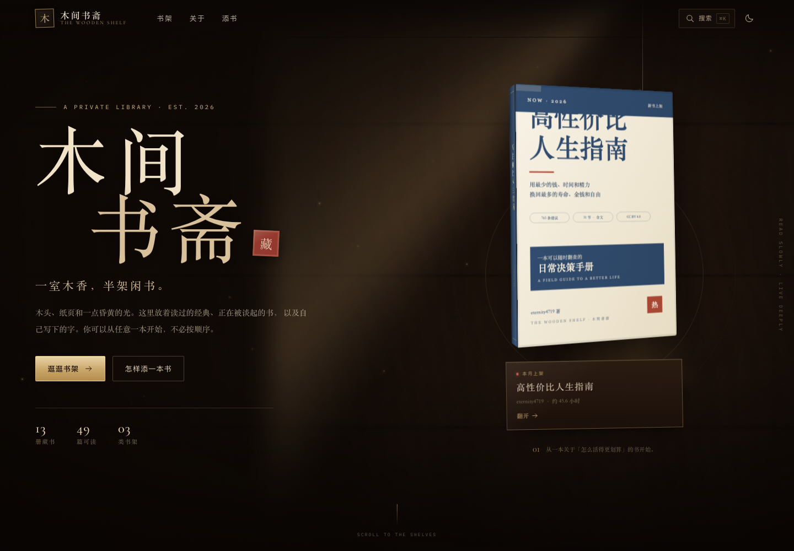
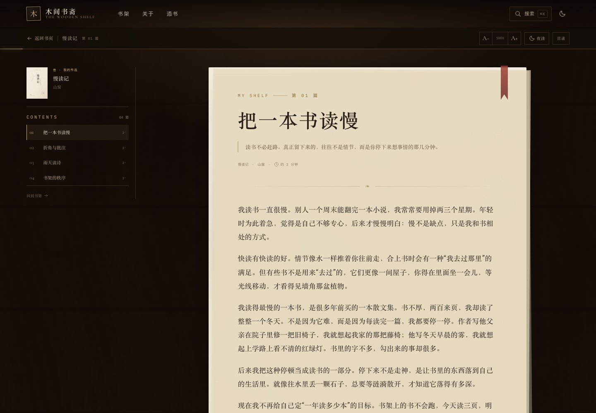

# 木间书斋 · The Wooden Shelf

一间用木头、纸页和光搭起来的私人书架。用 **Astro + Tailwind CSS** 构建，纯静态部署。

- 三层书架：经典名著、当下热门、我的作品
- 木纹、纸纹、 3D 书脊与抽出效果，全部由本地 CSS / 生成的纹理完成，不依赖远程图片
- 书籍详情页 + 纸页阅读器（字号、纸页/夜读、目录、进度、键盘翻页）
- 搜索目录柜（⌘K / Ctrl+K）
- PDF 藏本使用 PDF.js 在本地渲染，支持翻页、缩放、下载
- 添加书籍：Markdown 直接放，PDF / EPUB / TXT 用一条命令上架，封面自动生成



| 书架 | 阅读器 | PDF 翻阅 |
| --- | --- | --- |
|  |  |  |

## 快速开始

需要 Node.js 20+（本项目在 Node 24 下开发）。

```bash
pnpm install
pnpm dev       # 打开终端里提示的地址，通常是 http://localhost:4321
pnpm build     # 生成 dist/ 静态站点
pnpm preview   # 本地预览构建结果
```

如果端口被占用，Astro 会自动换一个端口，以终端输出为准。

## 现在书架里有什么

| 分类 | 内容 | 收录方式 |
| --- | --- | --- |
| 经典名著 | 《红楼梦》《西游记》《三国演义》《水浒传》《论语》《庄子》《聊斋志异》《儒林外史》 | 原创导读 + 短书摘，附公版全文链接 |
| 当下热门 | 《高性价比人生指南》eternity4719 | **全文**，依 CC BY 4.0 收录 |
| 我的作品 | 《慢读记》《山窗小札》《夜航手记》 | 原创示例 Markdown 文集 |
| 我的作品 | 《添书记》 | PDF 示例，用来演示 PDF 藏本 |

《高性价比人生指南》全文来自 [eternity4719/HowToLiveBetter](https://github.com/eternity4719/HowToLiveBetter)，
作者 eternity4719，依 [CC BY 4.0](https://creativecommons.org/licenses/by/4.0/) 许可收录并署名。
书中内容为一般信息，不构成医疗、法律或财务建议。

> 「我的作品」中的三本文集和《添书记》都是示例，用来演示 Markdown / PDF 上架流程，
> 可以直接删除或替换成你自己的文字。替换时记得同步 `src/content/library/own/` 下的 `book.yaml`。

## 添一本书

### 方式一：命令行（推荐）

```bash
pnpm book:new
```

按提示输入书名、作者、分类、格式和文件路径。脚本会：

1. 在 `src/content/library/<分类>/<slug>/` 下创建 `book.yaml` 与 `chapters/`；
2. 复制 PDF / EPUB 到 `public/library/<slug>/`；
3. 把 TXT / Markdown 拆成章节；
4. 在 `public/covers/` 生成一张与分类风格一致的 SVG 封面。

也可以直接传参数，适合脚本化：

```bash
# 自己的作品：先建一个空 Markdown 书
pnpm book:new -- --title "我的新书" --author "木间主人" --category own --slug my-book

# 其他作品：把 PDF 收进书架
pnpm book:new -- --title "一本书" --author "作者" --category classics --file ./book.pdf

# EPUB / TXT / Markdown 同理
pnpm book:new -- --title "旧稿" --author "作者" --category own --file ./manuscript.md
```

可用的文件格式：

| 格式 | 上架后的样子 |
| --- | --- |
| `markdown` | 站内全文阅读，支持多章节 |
| `pdf` | 站内 PDF.js 翻阅 + 下载 |
| `epub` | 提供下载，在阅读器中打开 |
| `txt` | 导入时按章节标题或长度自动拆分 |
| `link` | 只放一个指向原站的外链入口 |

### 方式二：直接编辑文件

```
src/content/library/
└── own/
    └── my-book/
        ├── book.yaml
        └── chapters/
            ├── 01.md
            └── 02.md
```

`book.yaml` 的最小写法：

```yaml
slug: my-book
title: 我的新书
author: 木间主人
category: own          # classics | trending | own
description: 一本刚刚放上书架的书。
cover: /covers/my-book.svg
accent: "#6b6a3c"
motif: leaf
order: 4
```

`chapters/01.md`：

```md
---
title: 第一篇
book: my-book
order: 1
summary: 一句话介绍这一篇。
---

正文从这里开始。
```

- `slug` 只能是小写字母、数字、连字符，用于 URL。
- `cover` 可换成自己的图片；不填的话，`pnpm covers` 会生成。
- `accent` 决定书脊和封面的主色；`motif` 可选
  `moon / mountain / wave / bamboo / cloud / plum / lantern / window / boat / leaf / stack / grid`。
- `order` 控制同层书架上的顺序。

新增或修改后：

```bash
pnpm covers --force   # 重新生成全部封面（会覆盖 public/covers 里同名 SVG）
pnpm dev              # 预览
```

## 项目结构

```
src/
├── components/          Navbar / Hero / Shelf / Book3D / Search / Footer / Icon / Decor
├── content.config.ts    Astro Content Collections：books + chapters
├── content/library/      书的数据与正文
│   ├── classics/<slug>/book.yaml + chapters/*.md
│   ├── trending/<slug>/...
│   └── own/<slug>/...
├── data/site.ts         站名、描述、分类、导航
├── layouts/BaseLayout.astro
├── lib/library.ts       取书、排序、阅读时间、链接等工具
├── pages/
│   ├── index.astro           首页三层书架
│   ├── book/[slug].astro     书籍详情
│   ├── read/[slug]/[chapter].astro   Markdown 阅读器
│   ├── read/[slug]/pdf.astro        PDF.js 阅读器
│   ├── about.astro           关于 + 添书指南
│   ├── search.json.ts        搜索索引
│   ├── rss.xml.ts / 404.astro
└── styles/global.css    主题变量、纸页排版、阅读器样式
public/
├── covers/              SVG 封面
├── textures/            程序化生成的木纹、纸纹、噪点
├── library/             被上架的 PDF / EPUB 文件
├── og.png               社交分享图
└── favicon.svg
scripts/
├── add-book.mjs         添书命令
├── make-covers.mjs      生成封面
├── make-textures.py     生成木纹 / 纸纹（可选，需要 Pillow + numpy）
├── import-trending.mjs  从 GitHub 导入《高性价比人生指南》
├── make-sample-pdf.mjs  生成《添书记》示例 PDF
└── make-og.mjs          生成 public/og.png
```

## 改成你自己的书房

### 站名与域名

修改：

- `src/data/site.ts`：站名、副标题、描述、作者、邮箱、社交链接、分类文案
- `astro.config.mjs`：`site` 改成你的正式域名
- `public/og.png` 可用 `pnpm og` 重新生成（需本机有 Playwright Chromium）

目录、分类 key 如果改动，记得同步 `src/data/site.ts`、`src/content.config.ts` 和 `src/content/library/` 的目录名。

### 主题

`src/styles/global.css` 顶部是两套主题变量：

- 默认「烛光」：深木色 + 铜金，适合夜读
- `data-theme="day"`：「日光」：浅木色 + 墨色

导航右上角可以切换，偏好存在 localStorage。书架纸张、阅读器纸页也可以在阅读页右上角切换「纸页 / 夜读」。

### 纹理与封面

木纹、纸纹是 `scripts/make-textures.py` 用 Pillow + numpy 生成的。它们已经提交到 `public/textures/`，正常使用不需要重新生成。想调整颜色/纹理：

```bash
python3 scripts/make-textures.py
```

需要 Python 3 + Pillow + numpy。脚本是程序化生成，不需要联网。

封面是 `scripts/lib/covers.mjs` 生成的 SVG，按 `classics / trending / own` 有三种版式。改 `book.yaml` 的 `accent`、`motif` 和标题，再运行 `pnpm covers --force`。

### 内容来源与许可

- **经典名著**：公版作品，本站只收录原创导读与短书摘，并链接到维基文库 / CText。
- **高性价比人生指南**：CC BY 4.0，保留作者与许可署名；`pnpm import-trending` 可以从 jsDelivr 重新拉取并转换全文。
- **我的作品**：示例内容为原创，可自由替换。

如果要加入受版权保护的书，请只放你自己的合法副本或外链，并遵守对应许可。不要在没有授权的情况下把整本书上传到公开站点。

## 部署

构建产物在 `dist/`，可以部署到任意静态托管：

```bash
pnpm build
```

- **Vercel / Netlify / Cloudflare Pages**：Build command `pnpm build`，Output `dist`。
- **GitHub Pages**：如果是项目页（`https://name.github.io/repo/`），需要在 `astro.config.mjs` 里设置
  `base: "/repo/"`，并把站内绝对路径 `/...` 改成带 base 的路径；最省事的做法是部署到自定义域名或根路径。
- PDF 阅读器是纯前端 PDF.js，不需要服务端；确保部署平台把 `.pdf` 作为静态文件直接返回。

## 可选的本地脚本

这些脚本用于生成静态资源 / 截图，不是运行网站的必需条件：

```bash
pnpm covers             # 补齐缺失封面
pnpm covers --force     # 重新生成所有封面
pnpm import:trending    # 重新导入《高性价比人生指南》（联网）
pnpm sample:pdf         # 重新生成《添书记》PDF
pnpm og                 # 重新生成 public/og.png（需要 Playwright Chromium）
node scripts/qa-shots.mjs http://127.0.0.1:4321 1440 1000 /tmp/home
```

`playwright-core` 是开发依赖，脚本里使用的是本机缓存的 Chromium；换机器后需要安装对应浏览器或修改路径。

## 技术栈

- [Astro 6](https://astro.build) — 静态站点、Content Collections、Markdown 渲染
- [Tailwind CSS 4](https://tailwindcss.com) — 基础层、主题变量与常用 utilities（通过 PostCSS 接入；木纹、3D、阅读排版用自定义 CSS）
- [PDF.js](https://mozilla.github.io/pdf.js/) — PDF 本地渲染
- CSS 3D transforms、IntersectionObserver、原生 `<dialog>`、localStorage
- 本地生成的木纹 / 纸纹 + 纯 SVG 封面

## 已知的小事

- 站点里的 `site.url`、邮箱、GitHub 链接是占位符，正式发布前替换。
- 示例作品与示例 PDF 可以直接删掉；删除后首页统计会自动更新。
- 如果 PDF 页面在极旧的浏览器里打不开，页面会显示下载回退。
- 阅读器字号/纸页模式、站点明暗主题都会记住上次选择。

—

一室木香，半架闲书。
